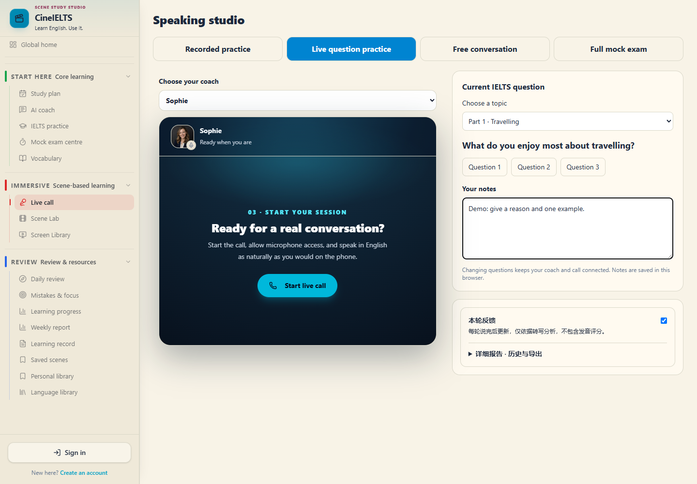
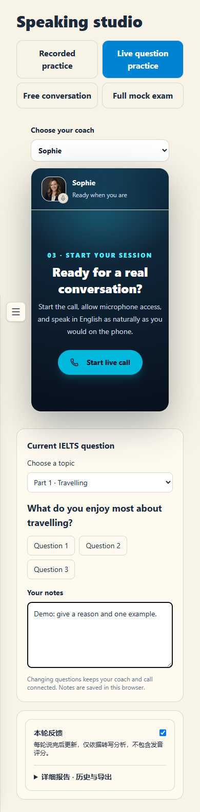
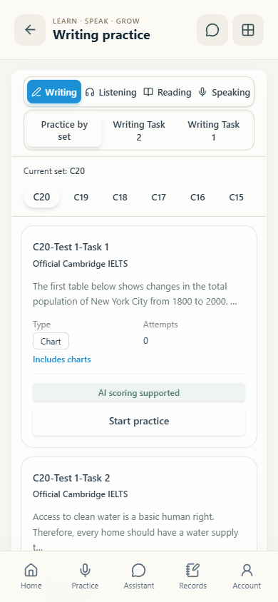

# CineIELTS

### Learn English in context. Practise with purpose.

CineIELTS is an independently developed, AI-assisted IELTS preparation platform connecting scene-based English learning with listening, reading, writing and speaking practice. It brings study planning, practice feedback and personal learning resources into one workflow.

**This is a project showcase repository. Application source code is not published here.**

## Explore the platform

| Edition | Website |
| --- | --- |
| International edition | [global.cineielts.cn/global](https://global.cineielts.cn/global) |
| China edition | [cineielts.cn](https://cineielts.cn) |

The international edition is the suggested starting point for English-speaking reviewers. Some features require an account, microphone permission or configured AI services.

*Representative development-preview screenshot. No real learner account or conversation is shown. The live interface may differ, and some preview labels remain in Chinese.*

## What the project brings together

| Area | Experience |
| --- | --- |
| Speaking practice | Recorded answers, live question practice, free conversation and mock-exam workflows with AI coaching support. |
| Writing practice | Task 1 and Task 2 practice with AI-assisted feedback and revision support. |
| Listening and reading | Dedicated practice areas within the same study environment. |
| Scene-based learning | Learn expressions, ideas and vocabulary in film and television contexts, then connect them to IELTS topics. |
| Study planning | Personalized plans that connect goals, practice and review. |
| Learning records | Vocabulary, saved expressions, personal resources, mistakes and practice history support ongoing review. |

## My contribution

I independently developed CineIELTS as a personal full-stack project, covering the learner experience, frontend and backend implementation, AI and speech-service integration, deployment and iteration of the China and international editions. I used AI coding tools during development and remained responsible for product decisions, integration and delivery.

The project demonstrates how a learning product can connect content discovery, guided practice, feedback and review, rather than presenting each feature as a separate tool.

## Technology overview

| Layer | Technologies |
| --- | --- |
| Interface | React, TypeScript, Vite, Tailwind CSS |
| Application services | Python, FastAPI, SQLAlchemy, HTTP and WebSocket workflows |
| Data and caching | PostgreSQL, Redis; SQLite for lightweight local development |
| AI and speech | LLM integration, speech recognition and speech synthesis |
| Delivery | Container-based deployment and separate regional editions |

This table is a high-level overview, not a release of implementation files or deployment configuration.

## Mobile interface

  
  

*Existing development-preview screenshots are used to show the product's interface. They are illustrations of the project, not proof that a live AI call or a complete practice session has been tested by a visitor.*

## For application reviewers

> CineIELTS is my independently developed AI-assisted IELTS preparation platform. It combines personalized study planning, AI speaking practice, writing feedback and scene-based language learning within a full-stack web application. I implemented the frontend and backend, integrated AI and speech services, and deployed China and international editions. This repository presents the product and links to its live websites; its application source code remains private.

For a quick review, open the international website, explore the practice areas and speaking studio, then look at how planning and review connect to the learning workflow.

## What is published here

- English project description and contribution summary.
- Selected product screenshots.
- Links to the live China and international editions.
- A [short project overview](docs/PROJECT_OVERVIEW.md).

There is no frontend or backend source, compiled application, database, user record, API credential or deployment configuration in this repository. Clone/download provides presentation materials only; it does not provide a runnable copy of CineIELTS.

## Project and content notes

Created by [gaoqiqian](https://github.com/gaoqiqian). This showcase does not grant an open-source license to the private application. Third-party names and any content visible within screenshots remain with their respective owners. CineIELTS is an independent preparation project; its AI practice feedback is not an official IELTS examination result.
